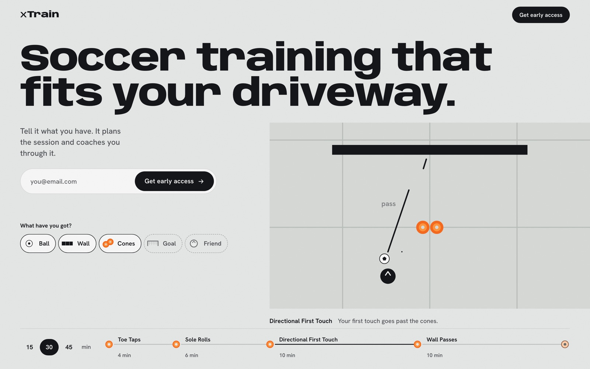

# xTrain

xTrain is an AI soccer-training app for players who train on their own. You tell it what you have (a ball, a wall, cones, a goal, a friend, and how many minutes) and it plans a session from the team's drill library, takes you through it one drill at a time, and adjusts the next drill based on how the last one felt.



There are five of us on the team, and my part was the technical drill library and the movement scanner. I also made this repo with Claude Code: the first version of the landing page and its drill renderer, from October 2026. `public/js/field.js` draws and animates any drill from data, and `public/js/drills.js` holds drills from the team's library.

The team's current site is <https://xtrain-soccer.vercel.app> (this page's first address, xtrain-pi.vercel.app, forwards there now), and the app's code is public on GitLab at <https://gitlab.com/xtrain1/xTrain-project>. The earlier React prototype is at the git tag `prototype-final`.

## Run it

```bash
npm run serve        # static preview at http://localhost:4321 (no build step)
vercel dev           # same, plus the /api/join signup function
```

Two query strings are handy: `?motion=off` shows every animated state at rest, and `?kit=wall,cones&min=45` opens on a given setup.

## What's where

| Path | What |
|---|---|
| `public/index.html` | The page |
| `public/css/site.css` | All styles. Tokens at the top |
| `public/js/drills.js` | Drill data from the team's Drill Library and the demo session planner |
| `public/js/field.js` | Draws and animates any drill from data (cones, ball, wall, goal, routes) |
| `public/js/main.js` | Hero kit state, session lane, pinned session, too easy / too hard, drill strip, signup |
| `public/vendor/` | GSAP 3.15 with plugins, Lenis 1.3.26 (see `VERSIONS.md`) |
| `api/join.js` | Early-access signups, stored privately in Vercel Blob |
| `docs/BUILD-PROMPT.md` | The prompt the page was built from |
| `docs/research/` | Notes on the reference site, competitors, and 20 design references |
| `PRODUCT.md`, `DESIGN.md` | Product notes and the design system |

## Signups

Each signup is stored as one private JSON file in the project's Blob store. To export them:

```bash
vercel env pull .env.local
npm install
npm run signups > signups.csv
```

## Deploy

`vercel --prod` from the repo root. The Vercel project is `xtrain`.

## Credits

Type: Mona Sans (SIL Open Font License, `public/assets/fonts/OFL.txt`). Icons: Phosphor (MIT). Animation: GSAP (standard no-charge license) and Lenis (MIT).
